# Anträge verwalten

## Antragsübersicht

Nach der Anmeldung siehst du die **Antragsübersicht** mit allen eingereichten Anträgen deiner EEG(s).

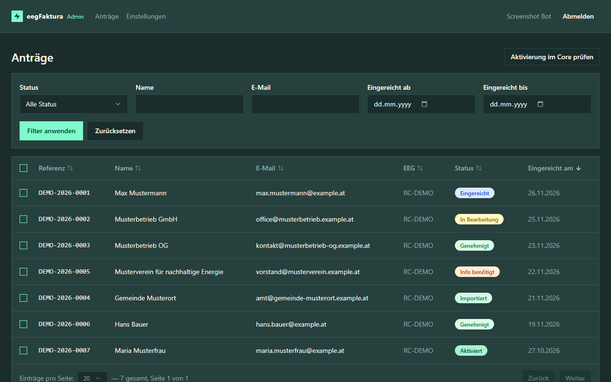

### Toolbar-Aktionen

Rechts oben in der Übersicht stehen dir zwei Aktionen zur Verfügung:

- **„Aktivierung im Core prüfen"** — fragt für alle Anträge im Status „Bereit zur Aktivierung" beim eegFaktura-Core nach. Das **Auslöse-Kriterium** ist pro EEG konfigurierbar (Einstellungen → „Aktivierungs-Kriterium"):
  - *Variante A* (Default): Mitglied im Core ist auf Status `ACTIVE`.
  - *Variante B*: mindestens ein Zählpunkt im Core hat `processState = ACTIVE` (die Netz-Registrierung beim Netzbetreiber ist abgeschlossen — das Mitglied ist wirklich aktiv).

  Trifft das Kriterium zu, wird der Antrag automatisch auf **„Aktiviert"** gesetzt und das Mitglied bekommt die volle Beitrittsbestätigungs-Mail mit PDF. Toast zeigt das Ergebnis (z. B. „3 von 5 auf Aktiviert gesetzt") und die Liste wird neu geladen.
- **„Alle Entwürfe löschen"** — erscheint nur, wenn Entwürfe existieren; löscht unwiderruflich alle nicht eingereichten Anträge deiner EEG(s).

Nach „Aktivierung im Core prüfen" kann sich die Liste **„Datenfreigabe ausständig"** öffnen, siehe [unten](#erinnerung-zur-datenfreigabe).

Die Tabelle zeigt:
- **Referenznummer** — eindeutige Kennung des Antrags
- **Name** — Mitgliedsname oder Firmenname
- **E-Mail** — Kontaktadresse des Mitglieds
- **EEG** — Kurzform der zugehörigen EEG (z. B. `EEG-Test`). Bei Hover über die Zelle erscheint die vollständige Referenznummer als Tooltip. Sobald die Kurzform noch nicht aus eegFaktura synchronisiert wurde, zeigt die Spalte die reine Referenznummer als Fallback. Die Sortierung der Spalte erfolgt weiterhin nach der Referenznummer.
- **Status** — aktueller Bearbeitungsstand
- **Eingereicht am** — Datum und Uhrzeit der Einreichung (Anzeige in Europe/Vienna)

Die Mitgliedsnummer ist nicht in der Liste, sondern erst in der Detailansicht eines Antrags sichtbar (sie wird erst beim Import vergeben und kann alphanumerisch sein, z. B. `A005`).

## Anträge filtern

Über das **Filterpanel** kannst du die Anträge gezielt einschränken:

| Filter | Beschreibung |
|--------|-------------|
| **Status** | Nur Anträge mit einem bestimmten Status anzeigen (Entwurf, Eingereicht, E-Mail bestätigt, In Bearbeitung, Info benötigt, Genehmigt, Abgelehnt, Importiert, Import fehlgeschlagen, **Bereit zur Aktivierung**, **Aktiviert**) |
| **Name** | Teilsuche über Vorname, Nachname und Firmenname (z. B. findet „Must" sowohl „Max Mustermann" als auch eine Firma „Musterbetrieb GmbH") |
| **E-Mail** | Teilsuche in der E-Mail-Adresse |
| **EEG** | Nur Anträge einer bestimmten EEG anzeigen (erscheint nur bei Admins mit mehreren EEGs). Die Liste zeigt sobald die Stammdaten synchronisiert wurden das Format `Kurzform • RC-Nummer` (z. B. `EEG-Test • RC0001`). Sortierung alphabetisch nach Kurzform — EEGs ohne Kurzform landen am Ende. |
| **Eingereicht ab / bis** | Zeitraum der Einreichung (Datumsbereich) |

## Massenaktionen

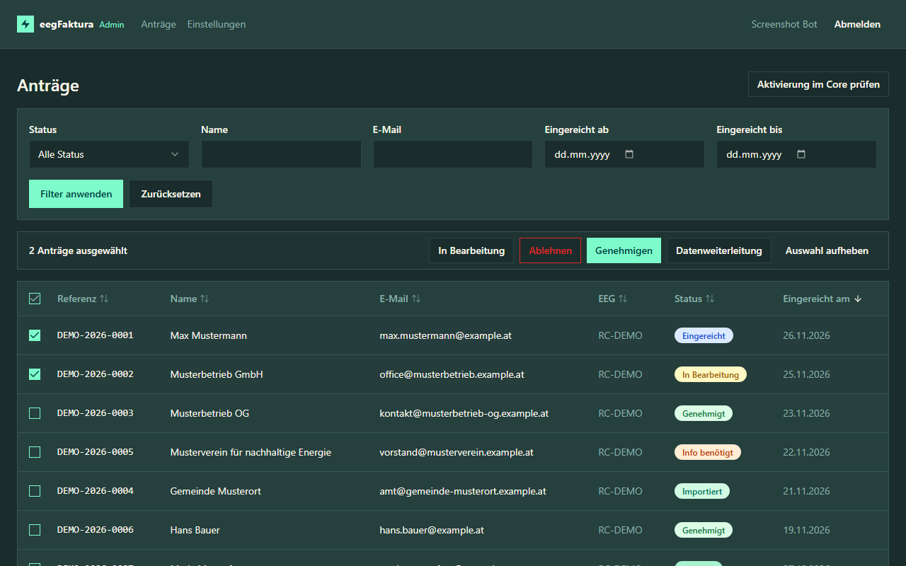

Über die Checkbox am Zeilenanfang kannst du mehrere Anträge gleichzeitig auswählen. Sobald mindestens ein Antrag selektiert ist, erscheint eine Aktionsleiste:

| Aktion | Wirkung |
|---|---|
| **In Bearbeitung** | Setzt alle ausgewählten Anträge auf `under_review`. Übersprungen werden Anträge, die diesen Übergang nicht erlauben. |
| **Genehmigen** | Setzt alle erlaubten Anträge auf `approved`. |
| **Ablehnen** | Setzt alle erlaubten Anträge auf `rejected` — eine Begründung wird abgefragt und am Antrag protokolliert. |
| **Datenweiterleitung** | Startet einen Datenexport-Job für die ausgewählten Anträge (siehe Einstellungen → [Datenweiterleitung](06-admin-settings.md#datenweiterleitung)). |
| **Auswahl aufheben** | Setzt die Auswahl zurück. |

Ein Toast zeigt nach der Aktion, wie viele Anträge tatsächlich umgesetzt wurden und wie viele übersprungen wurden (z. B. weil sie schon im Zielstatus waren).

## Sortieren

Klicke auf eine Spaltenüberschrift, um die Liste nach dieser Spalte zu sortieren:

* Erster Klick → aufsteigend (Pfeil ↑)
* Zweiter Klick → absteigend (Pfeil ↓)
* Dritter Klick → Standardsortierung (Pfeil ↕)

Die aktuelle Sortierung wird im Link in der Adressleiste mitgeführt, sodass du sortierte Ansichten teilen oder als Lesezeichen speichern kannst.

## Antrag öffnen

Klicke auf eine Zeile in der Tabelle, um die **Detailansicht** des Antrags zu öffnen.

## Detailansicht

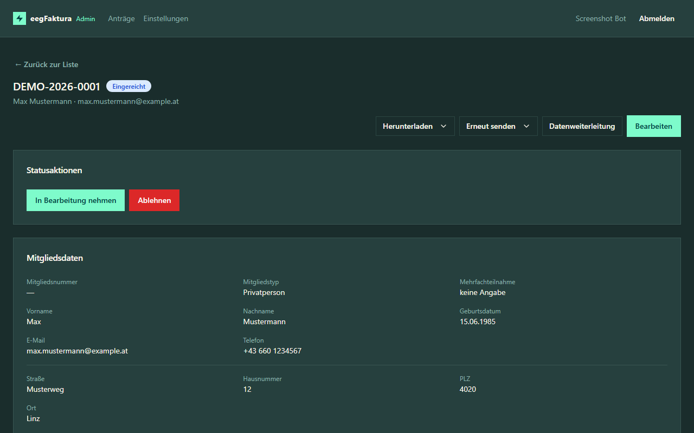

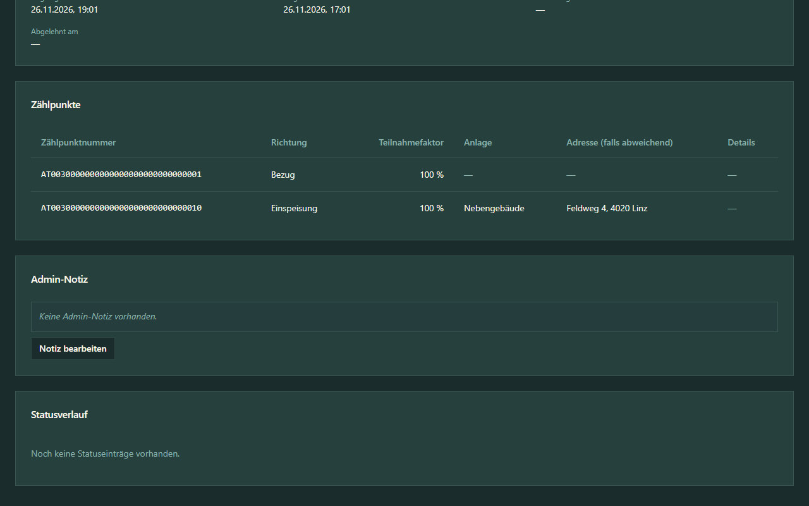

Die Aktionsleiste oben rechts gruppiert Aktionen in drei Dropdowns plus einzelne Top-Level-Buttons. Sichtbarkeit hängt vom aktuellen Status ab:

| Aktion | Dropdown / Top-Level | Wann verfügbar |
|--------|---------------------|----------------|
| **Excel** | Herunterladen | ab Status *Genehmigt* |
| **Beitrittsbestätigung** | Herunterladen | ab Status *Genehmigt* |
| **Beitrittserklärung** | Herunterladen | jederzeit, auch ohne Vorstands-Genehmigungs-Workflow |
| **SEPA-Mandat / Beitrittsbestätigung / Beitrittserklärung** | Nach eegFaktura hochladen | Ab Status *Importiert* (gleiche Dokumente wie unter „Herunterladen"; die Beitrittserklärung nur bei Status *Aktiviert* + Vorstands-Genehmigungs-Workflow), siehe [unten](#dokumente-nach-eegfaktura-hochladen) |
| **Bestätigungs-Mail** *(oder „Bestätigungs-Link" bei pendender E-Mail-Bestätigung)* | Erneut senden | jederzeit |
| **Info-Anforderung** | Erneut senden | Status *Info benötigt* |
| **Erinnerung Datenfreigabe** | Erneut senden | Status *Bereit zur Aktivierung* oder *Aktiviert*, siehe [unten](#erinnerung-zur-datenfreigabe) |
| **SEPA-Mandat** | Erneut senden | Status *Aktiviert* |
| **Stammdaten abgleichen** | Top-Level | Status *Aktiviert* (greift auf den Faktura-Core zu) |
| **Datenweiterleitung** | Top-Level | jederzeit |
| **Löschen** | Top-Level (destruktiv) | Status *Entwurf* oder *Abgelehnt* |
| **Bearbeiten** | Top-Level (primär) | Status *Eingereicht* / *In Prüfung* / *Rückfrage* / *Genehmigt* / *Import fehlgeschlagen* |
| **Import zurücksetzen** | Status-Block (destruktiv) | Status *Importiert* / *Bereit zur Aktivierung* — bringt den Antrag zurück auf *Genehmigt*, damit erneut importiert werden kann |
| **Auf Prüfung zurücksetzen** | Status-Block (destruktiv) | Status *Importiert* oder *Bereit zur Aktivierung* — bringt den Antrag zurück auf *In Prüfung*. Geeignet wenn der Antrag inhaltlich verworfen werden soll: nach diesem Schritt erreichbar ist *Ablehnen*. Mitgliedsnummer und alle Import-Verknüpfungen werden genullt. |
| **Aktivierung zurücksetzen** | Status-Block (destruktiv) | Status *Aktiviert* — bringt den Antrag zurück auf *Bereit zur Aktivierung*. Geeignet wenn die Aktivierung versehentlich passiert ist (manueller Klick oder Auto-Aktivierungs-Check trotz fehlender Core-Aktivität). Von dort ist der Antrag jederzeit wieder aktivierbar (manuell oder über die Core-Prüfung). Mitgliedsnummer + Core-Verknüpfung bleiben erhalten. |

**Info-Anforderung erneut senden:** Reagiert ein Mitglied nicht auf deine Rückfrage, öffnet **Erneut senden → Info-Anforderung …** einen Dialog mit dem Text deiner letzten Rückfrage. Du kannst ihn unverändert abschicken oder vorher anpassen; das Mitglied bekommt dieselbe Mail wie beim ersten Mal, samt Link zum Bearbeiten des Antrags. Der gesendete Text gilt danach als letzte Rückfrage und steht so in der Antragsansicht. Jeder Versand steht im Verlauf des Antrags („Info-Anforderung erneut gesendet“, bei geändertem Text mit dem neuen Text).

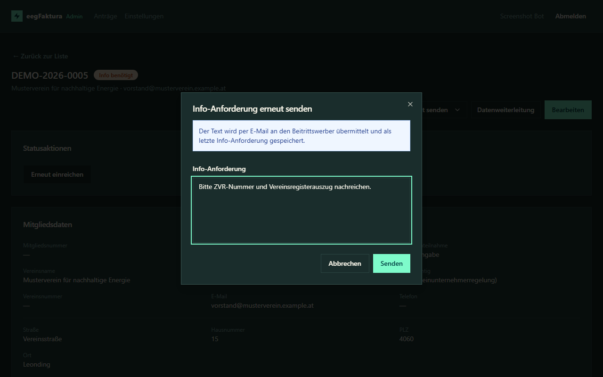

Die Detailansicht zeigt alle Angaben des Mitglieds:

- **Statusaktionen** — verfügbare Aktionen je nach aktuellem Status
- **Mitgliedsdaten** — Mitgliedstyp, Name, Geburtsdatum, Kontakt, Adresse
- **Zusatzangaben** — Beitrittsdatum, Personen im Haushalt, Wärmepumpe, E-Auto (inkl. Anzahl + Jahres-km), Warmwasser elektrisch. Die Karte erscheint nur, wenn die EEG mindestens eines dieser Felder im Mitglieder-Formular aktiviert hat und das Mitglied einen Wert eingetragen hat.

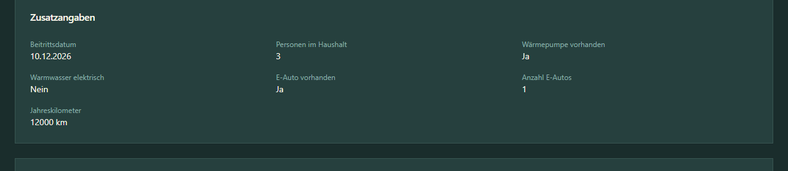
- **Bankverbindung** — IBAN, Kontoinhaber, SEPA-Mandat, Einzugsart und der Read-Only-Status „B2B-Vorbereitung" (Ja/Nein, siehe Abschnitt unten)
- **Einwilligungen** — Datenschutz und Richtigkeitsbestätigung
- **Antragsdaten** — Referenznummer, RC-Nummer, Mitgliedsnummer (nach erfolgreichem Import), Zeitstempel
- **Zählpunkte** — alle angegebenen Zählpunkte mit Richtung und Teilnahmefaktor
- **Admin-Notiz** — interne Notizen (nur für Admins sichtbar)
- **Statusverlauf** — chronologische Historie aller Statusänderungen
- **Dokumente in eegFaktura** — welche PDFs nach eegFaktura hochgeladen wurden (siehe nächster Abschnitt)

### Mehrfachteilnahme

Hat die EEG die Frage zur Mehrfachteilnahme eingeschaltet (siehe [Einstellungen](06-admin-settings.md#mehrfachteilnahme)), zeigen die Mitgliedsdaten die Zeile **Mehrfachteilnahme: Ja**, **Nein** oder **keine Angabe**. „Keine Angabe" steht bei älteren Anträgen und bei Anträgen über die externe API ohne Antwort. Ist die Frage ausgeschaltet, erscheint die Zeile nur, wenn der Antrag eine Antwort hat.

Im Dialog **Bearbeiten** setzt du den Wert auf Ja, Nein oder „keine Angabe" — auch dann, wenn die Frage inzwischen ausgeschaltet ist. Wie alle anderen Angaben im Antrag lässt sich die Antwort bearbeiten, solange der Antrag noch nicht importiert ist. So korrigierst du die Antwort, wenn sich das Mitglied umentschieden hat. Das Speichern anderer Änderungen lässt die Antwort unverändert.

### Zusatzinformation

Hat der Antrag eine Zusatzinformation, zeigt die Detailansicht sie als eigenen Abschnitt **Zusatzinformation** über der Admin-Notiz, mit allen Zeilenumbrüchen. Anders als die Admin-Notiz ist sie für das Mitglied bestimmt: Sie steht auf Beitrittsbestätigung und Beitrittserklärung, in der Eingangsbestätigung, in der Mail „Neuer Antrag“ und im Daten-Export. Nach eegFaktura wird sie nicht übertragen.

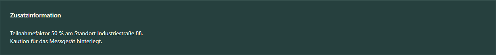

## Erinnerung zur Datenfreigabe

Bevor ein Zählpunkt Energie mit der EEG austauscht, muss das Mitglied im Online-Portal seines Netzbetreibers der Datenfreigabe für die EEG zustimmen. Vergisst es das, steht der Zählpunkt in eegFaktura auf „wartet auf Zustimmung" (`PENDING`). An diese Mitglieder kannst du eine Erinnerung schicken.

**Nach „Aktivierung im Core prüfen":** Warten bei Anträgen in *Bereit zur Aktivierung* oder *Aktiviert* noch Zählpunkte auf die Zustimmung, öffnet sich der Dialog **„Datenfreigabe ausständig"**. Er zeigt je Antrag das Mitglied, die betroffenen Zählpunkte und wie oft schon erinnert wurde. Alle Anträge, die jetzt erinnert werden dürfen, sind vorausgewählt. **„Erinnerung senden"** verschickt die Mail an die ausgewählten Mitglieder; danach steht bei jedem Antrag, ob sie rausging oder warum nicht.

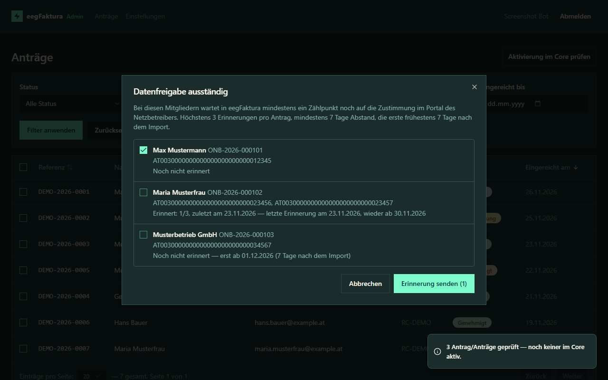

**Aus dem Antrag:** **Erneut senden → Erinnerung Datenfreigabe** schickt die Erinnerung an dieses eine Mitglied, wenn eegFaktura noch wartende Zählpunkte meldet.

Grenzen, damit niemand zu oft angeschrieben wird:

- die erste Erinnerung frühestens 7 Tage nach dem Import,
- danach mindestens 7 Tage Abstand,
- höchstens 3 Erinnerungen pro Antrag.

Gesperrte Anträge sind im Dialog nicht auswählbar, im Menü ist der Eintrag ausgegraut — jeweils mit dem Grund („wieder ab …", „bereits 3-mal erinnert"). Vor jedem Versand fragt das Onboarding eegFaktura erneut ab: Hat das Mitglied inzwischen zugestimmt, geht keine Mail raus. Jede Erinnerung steht im Verlauf des Antrags („Erinnerung Datenfreigabe gesendet (1/3): …"), Anzahl und Datum der letzten im Antrag unter den Import-Angaben. Setzt du den Import oder den Antrag auf Prüfung zurück, beginnt die Zählung neu — auch beim einfachen Wechsel aus „Bereit zur Aktivierung“ zurück in die Prüfung.

Den Text der Mail legst du in den Einstellungen fest, siehe [Erinnerung zur Datenfreigabe](06-admin-settings.md#erinnerung-zur-datenfreigabe-alle-optionen).

Ganz automatisch, ohne Klick, geht es nicht: Ob die Zustimmung schon da ist, weiß nur eegFaktura, und das Onboarding darf dort nur mit deiner Anmeldung nachsehen. Als Superuser zeigt der Check über alle EEGs keine Liste — er würde sonst jede EEG bei eegFaktura abfragen. Einzeln aus dem Antrag erinnern geht auch als Superuser.

## Dokumente nach eegFaktura hochladen

Du kannst SEPA-Mandat, Beitrittsbestätigung und Beitrittserklärung direkt beim Mitglied in eegFaktura ablegen — dort erscheinen sie unter den Dokumenten des Mitglieds als Vertrag. Hochgeladen wird genau das PDF, das du auch über **Herunterladen ▾** bekommst. Die Beitrittserklärung lässt sich allerdings nur bei Status *Aktiviert* und eingeschaltetem Vorstands-Genehmigungs-Workflow hochladen.

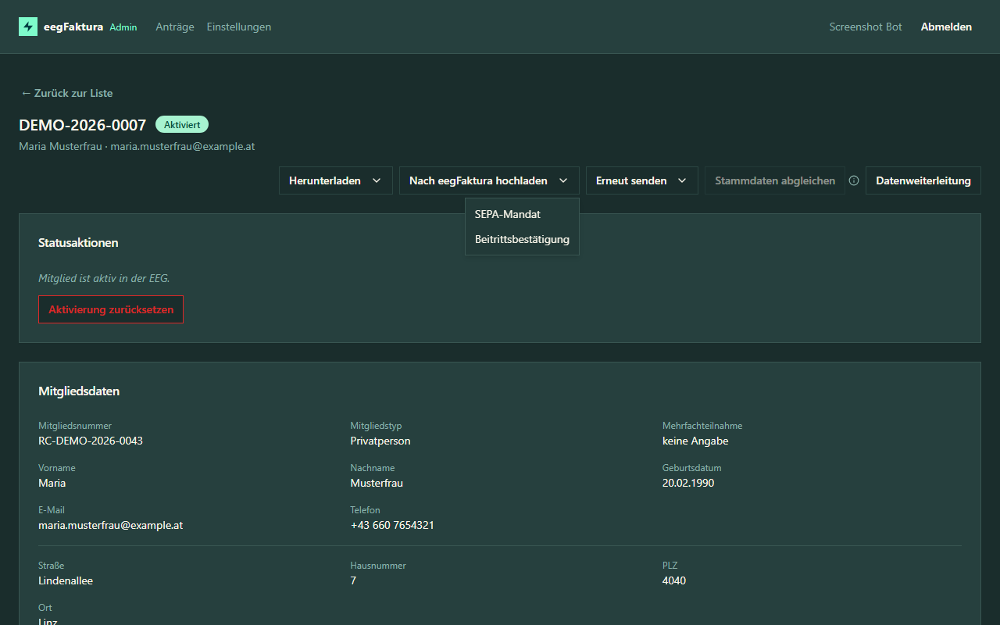

Das geht erst, wenn das Mitglied in eegFaktura existiert, also ab Status *Importiert* (auch *Bereit zur Aktivierung* und *Aktiviert*). Vorher ist das Menü **Nach eegFaktura hochladen ▾** nicht sichtbar.

1. Menü **Nach eegFaktura hochladen ▾** öffnen und das Dokument wählen.
2. Der Bestätigungsdialog nennt das Mitglied in eegFaktura, z. B. „Hochladen an Mitglied A015 · Max Mustermann in eegFaktura?". Prüfe den Namen — vor allem nach einer manuellen Aktivierung ohne Import, bei der das Mitglied über die eingetragene Mitgliedsnummer gesucht wird. Kann das Mitglied nicht gefunden werden, zeigt der Dialog den Grund und bietet kein Hochladen an.
3. **Hochladen** klicken. Während der Upload läuft, ist das Menü gesperrt. Danach erscheint eine Erfolgs- oder Fehlermeldung.

Wurde das Dokument schon einmal hochgeladen, fragt ein zweiter Dialog **Erneut hochladen?** nach und nennt das Datum des letzten Uploads. Bestätigst du, liegt das Dokument danach zweimal in eegFaktura; eine überzählige Kopie kannst du dort löschen.

Der Bereich **Dokumente in eegFaktura** listet jeden Versuch mit Dokument, Zeitpunkt, Ergebnis (*hochgeladen* oder *fehlgeschlagen* mit Grund, z. B. „eegFaktura nicht erreichbar"), Auslöser und Admin. Fehlgeschlagene Uploads werden nicht automatisch wiederholt — lade das Dokument später einfach erneut hoch.

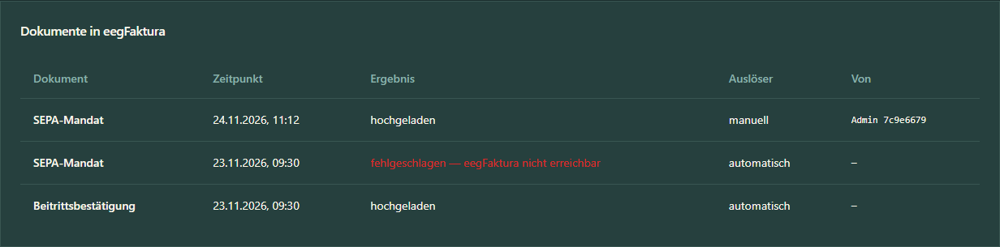

Hochgeladen wird immer die **unsignierte** Beitrittserklärung. Die vom Vorstand unterschriebene Fassung musst du weiterhin selbst in eegFaktura beim Mitglied ergänzen.

**Automatisch bei Aktivierung:** Sind in den EEG-Einstellungen Dokumente für den automatischen Upload eingeschaltet, lädt das Tool sie nach der Aktivierung im Hintergrund hoch. Diese Einträge erscheinen im Bereich **Dokumente in eegFaktura** mit Auslöser **automatisch**; als Admin steht dort, wer die Aktivierung ausgelöst hat. Ein Fehlschlag steht dort als *fehlgeschlagen* — lade das Dokument dann manuell nach. Bereits erfolgreich hochgeladene Dokumente lädt die Automatik nicht erneut hoch. Ändert sich das Mitglied in eegFaktura zwischen Bestätigungsdialog und Upload, bricht der Upload mit „Das Zielmitglied hat sich geändert — bitte erneut versuchen." ab und der Dialog fragt mit dem aktuellen Mitglied erneut.

## Antrag bearbeiten

Als Admin kannst du folgende Felder direkt korrigieren:

- Persönliche Daten und Adresse
- IBAN und Kontoinhaber
- Zählpunkte
- **Zusatzangaben** — Beitrittsdatum, Personen im Haushalt, Wärmepumpe, Warmwasser elektrisch, E-Auto (inkl. Anzahl + Jahres-km), Genossenschaftsanteile, Netzbetreiber-Vollmacht. Es werden nur die Felder angezeigt, die in den EEG-Einstellungen unter „Formular-Felder" auf „Optional", „Pflicht" oder „Nur Admin" stehen. Ein Feld mit Status „Ausgeblendet" erscheint weder im Mitglieder-Formular noch im Admin-Edit-Dialog — soll ein hidden-Feld vom Admin pflegbar werden, setze es in den Einstellungen auf „Nur Admin". Beim Deaktivieren des E-Auto-Toggles werden Anzahl und Jahres-Kilometer serverseitig gelöscht. Der Zeitstempel der Netzbetreiber-Vollmacht wird beim ersten Setzen serverseitig vergeben; ein nachträgliches Entfernen des Toggles ändert die Audit-Spur nicht.
- Admin-Notiz (interne Anmerkungen)

Klicke auf **Bearbeiten**, nimm die Änderungen vor und speichere.

### Zusatzinformation bearbeiten

Im Dialog **Bearbeiten** gibt es über der Admin-Notiz immer das mehrzeilige Feld **Zusatzinformation** (höchstens 2000 Zeichen), auch wenn das Feld im Beitrittsformular ausgeblendet ist. Dort hältst du individuelle Absprachen mit dem Mitglied fest, zum Beispiel: „Teilnahmefaktor 50 % im ersten Jahr. Depot: 500 €, Rückzahlung bei Austritt.“ Speichern ohne Änderung lässt den Text stehen; leerst du das Feld, wird die Zusatzinformation entfernt.

Änderst du den Text bei einem eingereichten Antrag (neu, geändert oder geleert), bekommt das Mitglied die E-Mail **„Zusatzinformation zu deinem Antrag geändert“** (bei Unternehmen und Gemeinden „Ihrem Antrag“) mit dem neuen Text bzw. dem Hinweis, dass sie entfernt wurde. Die Kontaktadresse der EEG bekommt eine Kopie. Speichern ohne Textänderung löst keine Mail aus. Verlangt deine EEG die Bestätigung der E-Mail-Adresse und hat das Mitglied sie noch nicht bestätigt, wird der Text gespeichert, aber keine Mail verschickt. Kann die Mail nicht versendet werden, bleibt die Änderung trotzdem gespeichert, und du siehst die Meldung **„Mitglied nicht informiert“** — informiere das Mitglied dann bitte selbst. Wie alle Angaben lässt sich der Text im Dialog **Bearbeiten** in den Status Eingereicht, In Bearbeitung, Rückfrage, Genehmigt und Import fehlgeschlagen ändern; nach dem Import nicht mehr.

Wurde die Mail zurückgehalten, weil das Mitglied seine E-Mail-Adresse noch nicht bestätigt hat, sagt dir ein Hinweis nach dem Speichern das.

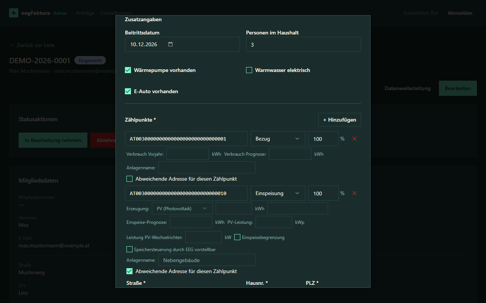

### Abweichende Adresse eines Zählpunkts

Liegt eine Anlage nicht an der Adresse des Mitglieds, setzt du beim Zählpunkt die Option **Abweichende Adresse für diesen Zählpunkt** und trägst Straße, Hausnummer, PLZ und Ort ein. Das geht bei bestehenden und bei neu hinzugefügten Zählpunkten. Hat das Mitglied im Beitrittsformular schon eine abweichende Adresse angegeben, ist die Option beim Öffnen an und die Felder sind befüllt. Ist die Option an, sind alle vier Felder Pflicht — fehlt eines, speichert der Dialog nicht und markiert die leeren Felder. Schaltest du die Option aus, wird die Adresse beim Speichern entfernt und der Zählpunkt übernimmt wieder die Adresse des Mitglieds. Beispiel: Max Mustermann wohnt in der Musterstraße 1, seine PV-Anlage steht am Anlagenweg 7 in Musterdorf.

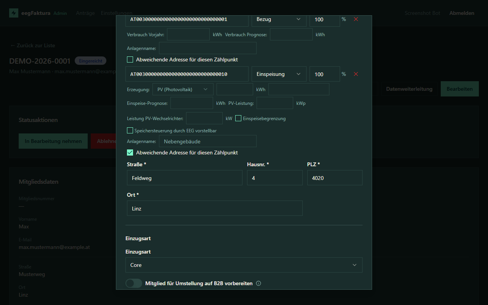

### Anlagenname eines Zählpunkts

Jeder Zählpunkt hat im Dialog **Bearbeiten** das Feld **Anlagenname**, zum Beispiel „Hauptanlage“ oder „Nebengebäude“. Das Feld ist immer da, auch wenn es im Beitrittsformular ausgeblendet ist. Der Anlagenname wird beim Import als Anlagenbezeichnung nach eegFaktura übernommen.

> **Hinweis:** Änderungen an Antragsdaten werden im Statusverlauf nicht automatisch protokolliert. Nutze die Admin-Notiz für wichtige Vermerke.

> **Hinweis:** Das Speichern der Admin-Notiz aktualisiert ausschließlich das Notizfeld — andere Antragsdaten (Mitgliedstyp, Zählpunkte, Teilnahmefaktor, …) werden dabei nicht überschrieben.

## B2B-Vorbereitung mitsenden

In der SEPA-Sektion des Bearbeiten-Dialogs erscheint bei Einzugsart „Core" der Toggle **„Mitglied für Umstellung auf B2B vorbereiten"**. Bei aktivem Toggle bekommt das Mitglied zusätzlich zum Basis-Lastschrift-Mandat (CORE) auch das Firmenlastschrift-Mandat (B2B) als zweites PDF — vorbereitet zur Vorlage bei der Hausbank. Im eegFaktura-Core wird der Antrag weiterhin als CORE angelegt; sobald die Hausbank den B2B-Mandatsantrag bestätigt hat, stellst du den SEPA-Typ im Faktura-Core manuell auf B2B um.

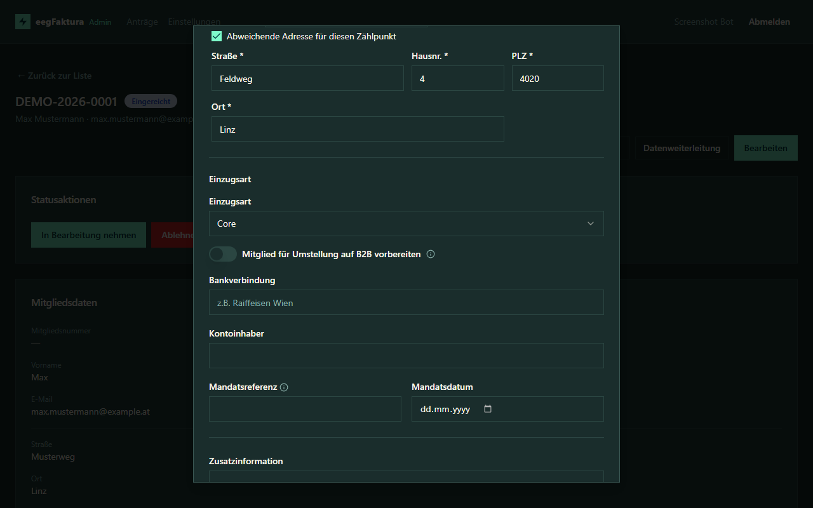

Praxis-Beispiel (Musterbetrieb GmbH): Im Bearbeiten-Dialog Einzugsart „Core" wählen, Toggle „Mitglied für Umstellung auf B2B vorbereiten" anhaken. Beim Import bekommt das Mitglied zwei Mandate (CORE + B2B). Die Buchhaltung der Musterbetrieb GmbH reicht das B2B-Mandat bei ihrer Hausbank ein. Nach Rückmeldung der Bank ändert der Admin im Faktura-Core den SEPA-Typ.

> **Wichtig:** Der Toggle wirkt zusammen mit der EEG-Einstellung *„SEPA-Mandat erst beim Import senden"* (siehe Admin-Einstellungen). Solange diese Einstellung deaktiviert ist, wird das Mandat schon beim Submit verschickt — in dem Fall geht das B2B-Mandat erst über die Aktion **„SEPA-Mandat erneut senden"** in der Antrags-Detailansicht raus. Empfehlung: aktiviere die EEG-Einstellung, wenn du den B2B-Vorbereitungs-Toggle regelmäßig nutzt.

In der Detail-Ansicht eines Antrags zeigt das Feld **„B2B-Vorbereitung: Ja / Nein"** den aktuellen Zustand. Übersichten, Filter und Badges enthalten diese Information bewusst nicht — sie ist nur in der Detail-Ansicht eines einzelnen Antrags relevant.

## Entwürfe löschen

Wenn ein Mitglied einen Antrag begonnen, aber nie eingereicht hat (Status `draft`), kannst du ihn aus der Übersicht entfernen. Die Massen-Löschaktion respektiert dabei den aktiven **EEG-Filter**:

* Filter auf eine bestimmte EEG gesetzt → nur Entwürfe dieser EEG werden gelöscht
* Kein EEG-Filter gesetzt (Superuser) → Entwürfe aller EEGs werden gelöscht

## E-Mail erneut senden

Falls ein Mitglied die Bestätigungs-E-Mail nicht erhalten hat, kannst du diese über den Button **E-Mail erneut senden** in der Detailansicht nochmals versenden.

## EEG umzuordnen

Falls ein Antrag fälschlich der falschen EEG zugeordnet wurde (Mitglied hat den falschen RC-Link verwendet), kann er als Admin direkt umzuordnen werden — ohne dass das Mitglied neu einreichen muss. Verfügbar nur für Admins mit Zugriff auf mehrere EEGs und nur solange der Antrag in der Review-Phase ist (`submitted` / `email_confirmed` / `under_review` / `needs_info`). Detail-Beschreibung siehe [Statusverwaltung → EEG umzuordnen](05-admin-status.md#eeg-umzuordnen).

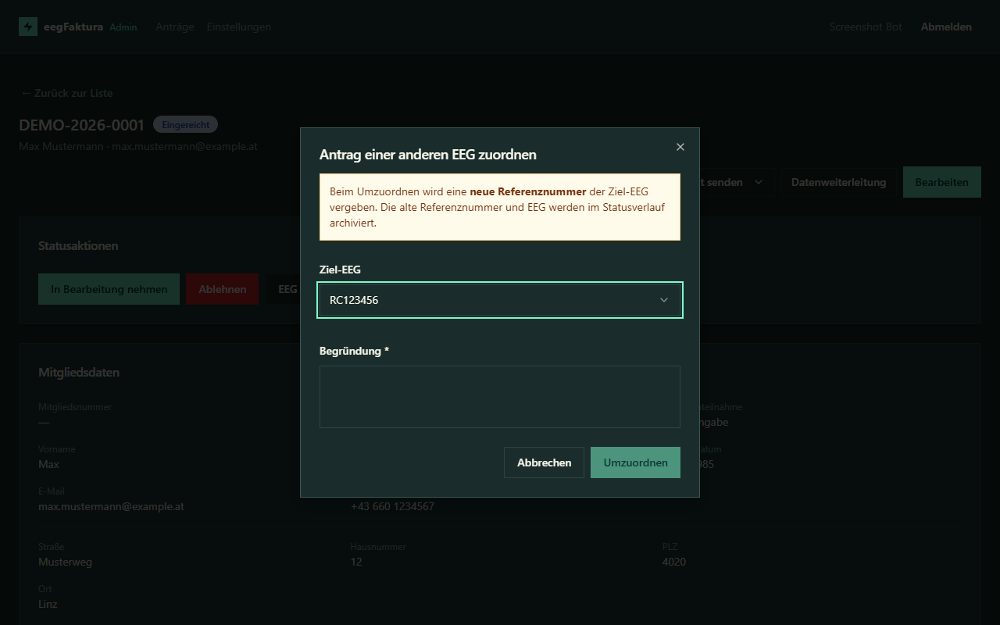
