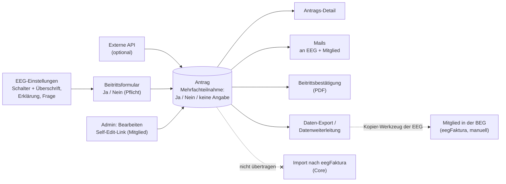

# PROJ-131: Abfrage „Mehrfachteilnahme" im Beitrittsformular

## Status: Architected
**Created:** 2026-11-08
**Last Updated:** 2026-11-08

## Dependencies
- Berührt: PROJ-1 (Public Registration), PROJ-11 (Einleitungstext — gleicher Editor und dieselbe Bereinigung), PROJ-13 (Externe API), PROJ-60/99/112 (Daten-Export, Feldkatalog), PROJ-41/127 (Mails), Beitrittsbestätigungs-PDF (PROJ-46), Admin-Bearbeiten (PROJ-24), Config-Export/-Import (PROJ-61), PROJ-121 (Self-Edit-Link)

## Hintergrund

Tester-Wunsch 2026-10-30 (WhatsApp): Viele regionale EEGs kooperieren mit einer Bürgerenergiegemeinschaft (BEG). Neue Mitglieder der EEG sollen beim Beitritt mit **Ja/Nein** angeben können, ob sie zusätzlich an der BEG teilnehmen möchten (Mehrfachteilnahme). Die EEG braucht dafür **viel Platz für Erklärungstext**. Ein Beispiel ist ein Abschnitt mit Überschrift, zwei Absätzen (Link zur BEG, Hinweis zum Teilnahmefaktor) und darunter der Frage mit Ja/Nein-Auswahl.

Ausdrücklich **nicht** nötig: das Mitglied automatisch auch in der zweiten eegFaktura-Gemeinschaft anzulegen. Die EEG kopiert das selbst mit einem eigenen Werkzeug, das die Antwort aus dem Export liest.

## Rückmeldung der Tester zur Spezifikation (WhatsApp 2026-11-08)

- **Umfang bestätigt:** Die Doppel-Anlage in der zweiten Gemeinschaft und die Regelung des Teilnahmefaktors sollen
  organisatorisch erfolgen, nicht im Member-Onboarding. Die anfragende EEG hat dafür ein eigenes Werkzeug gebaut, das
  sie auch anderen EEGs zur Verfügung stellen würde. Start mit dieser Anforderungsdefinition. Das bestätigt die
  Owner-Entscheidungen O1–O7 und „Out of Scope“.
- **Nebenbefund zum Dokumenten-Upload (PROJ-129, nicht Teil dieser Spec):** Bei einer EEG kommt die
  Beitrittserklärung erst in eegFaktura, wenn der Vorstand sie unterschrieben hat. Die automatisch hochgeladene,
  unsignierte Beitrittserklärung würde dort später durch die signierte Fassung ersetzt. Der Schalter je Dokument
  (Einstellungen → „Dokumente bei Aktivierung automatisch nach eegFaktura hochladen“) deckt das ab: Die EEG lässt
  „Beitrittserklärung (unsigniert)“ aus. Kein Handlungsbedarf, solange keine weitere EEG das anders braucht.

## Owner-Entscheidungen (2026-11-08)

| # | Entscheidung |
|---|---|
| O1 | **Ein festes Feld** „Mehrfachteilnahme gewünscht" (Ja/Nein). Die Texte legt jede EEG selbst fest. Es gibt keine beliebigen eigenen Fragen. |
| O2 | **Einmal je Antrag**, bezogen auf das Mitglied, nicht je Zählpunkt. |
| O3 | **Ein/Aus je EEG.** Standard ist aus. Ist die Frage eingeschaltet, muss das Mitglied Ja oder Nein wählen (Pflicht). Ein „optional“ gibt es nicht. |
| O4 | **Ausgabe:** Antrags-Detail und Bearbeiten (Admin), Daten-Export und Datenweiterleitung, Mails an EEG und Mitglied, Beitrittsbestätigung (PDF). |
| O5 | **Erklärungstext** im selben Editor wie der Einleitungstext (Fett, Kursiv, Absätze, Listen, Links), serverseitig gleich bereinigt. |
| O6 | **Neutrale Vorgabetexte.** Überschrift „Teilnahme an einer weiteren Energiegemeinschaft", Frage „Möchtest du zusätzlich an einer weiteren Energiegemeinschaft teilnehmen?", Erklärung leer. Die EEG kann alles anpassen. Speichern geht nur mit einem Frage-Text. |
| O7 | **Externe API** nimmt das Feld optional an und prüft es wie das Formular. Es wird dort nicht erzwungen. |

## Visualisierung der geplanten Lösung

Skizzen zur Abstimmung, kein endgültiges Design. Die Beispieltexte sind frei erfunden.

### 1. Einstellungen der EEG (Admin)

```
┌─ Einstellungen ▸ Formular ─────────────────────────────────────────────┐
│                                                                        │
│  Mehrfachteilnahme                                                     │
│  ────────────────────────────────────────────────────────────────────  │
│  [■ an ]  Frage zur Mehrfachteilnahme im Beitrittsformular anzeigen    │
│                                                                        │
│  Überschrift                                                           │
│  ┌──────────────────────────────────────────────────────────────────┐  │
│  │ Zusätzliche Energie aus Wind- und Wasserkraft                    │  │
│  └──────────────────────────────────────────────────────────────────┘  │
│                                                                        │
│  Erklärungstext                     [ B ] [ I ] [ • ] [ 1. ] [ 🔗 ]    │
│  ┌──────────────────────────────────────────────────────────────────┐  │
│  │ Als Mitglied kannst du gleichzeitig bei der Muster-BEG           │  │
│  │ mitmachen. Sie wird vor allem im Winter aus Windkraft            │  │
│  │ versorgt. Details unter www.muster-beg.at                        │  │
│  │                                                                  │  │
│  │ Den Teilnahmefaktor zwischen beiden Gemeinschaften passen wir    │  │
│  │ regelmäßig an; regionale Energie hat Vorrang.                    │  │
│  └──────────────────────────────────────────────────────────────────┘  │
│                                                                        │
│  Frage *                                                               │
│  ┌──────────────────────────────────────────────────────────────────┐  │
│  │ Möchtest du zusätzlich bei der Muster-BEG teilnehmen?            │  │
│  └──────────────────────────────────────────────────────────────────┘  │
└────────────────────────────────────────────────────────────────────────┘
```

Beim ersten Einschalten stehen in Überschrift und Frage die neutralen Vorgabetexte. Der Erklärungstext ist leer.

### 2. Beitrittsformular (Mitglied)

Der Abschnitt steht vor den Einwilligungen und erscheint nur, wenn die EEG die Frage eingeschaltet hat.

```
┌─ Beitrittsformular ────────────────────────────────────────────────────┐
│  … Persönliche Daten · Bankverbindung · Zählpunkte …                   │
│                                                                        │
│  Zusätzliche Energie aus Wind- und Wasserkraft                         │
│  ────────────────────────────────────────────────────────────────────  │
│  Als Mitglied kannst du gleichzeitig bei der Muster-BEG mitmachen.     │
│  Sie wird vor allem im Winter aus Windkraft versorgt.                  │
│  Details unter www.muster-beg.at  ← anklickbarer Link                  │
│                                                                        │
│  Den Teilnahmefaktor zwischen beiden Gemeinschaften passen wir         │
│  regelmäßig an; regionale Energie hat Vorrang.                         │
│                                                                        │
│  Möchtest du zusätzlich bei der Muster-BEG teilnehmen? *               │
│  ┌──────────────────────────────┐┌──────────────────────────────┐      │
│  │              Ja              ││             Nein             │      │
│  └──────────────────────────────┘└──────────────────────────────┘      │
│  (anfangs nichts gewählt; ohne Auswahl kein Absenden)                  │
│                                                                        │
│  … Einwilligungen · Antrag einreichen                                  │
└────────────────────────────────────────────────────────────────────────┘
```

Auf dem Handy (375 px) stehen „Ja" und „Nein" untereinander, jeweils über die volle Breite.

### 3. Antrags-Detail (Admin)

```
┌─ Antrag ONB-… · Max Mustermann ────────────────────────────────────────┐
│  Mitglied                                                              │
│    Name ............... Max Mustermann                                 │
│    E-Mail ............. max@example.org                                │
│    Mehrfachteilnahme .. Ja                       [Bearbeiten ✎]        │
│  …                                                                     │
└────────────────────────────────────────────────────────────────────────┘
```

Im Bearbeiten-Formular lässt sich der Wert auf Ja, Nein oder „keine Angabe" setzen.

### 4. Weg der Antwort



Die Antwort bleibt im Onboarding. Ins eegFaktura der BEG kommt das Mitglied über das eigene Kopier-Werkzeug der EEG, das den Export liest. Beim Import nach eegFaktura wird die Antwort nicht mitgegeben.

## User Stories

- Als **EEG-Admin** möchte ich im Beitrittsformular eine Ja/Nein-Frage zur Teilnahme an unserer Partner-BEG einschalten, damit neue Mitglieder gleich beim Beitritt entscheiden.
- Als **EEG-Admin** möchte ich Überschrift, Erklärungstext (mit Absätzen und Links) und Frage selbst formulieren, damit Mitglieder verstehen, worauf sie sich einlassen.
- Als **Mitglied** möchte ich die Erklärung lesen und dann Ja oder Nein wählen, damit meine Entscheidung festgehalten ist.
- Als **EEG-Admin** möchte ich die Antwort im Antrag, in den Mails, im PDF und im Export sehen, damit ich Mitglieder, die zugestimmt haben, in die BEG übernehmen kann.
- Als **EEG-Admin** möchte ich eine falsche Antwort im Antrag korrigieren können, wenn sich das Mitglied umentscheidet.

## Acceptance Criteria

**Einstellungen**
- [ ] AC-1: In den EEG-Einstellungen gibt es den Abschnitt „Mehrfachteilnahme".
  - Er enthält einen Schalter (Standard: aus), die Überschrift (einzeilig), den Erklärungstext (Editor wie beim Einleitungstext) und die Frage (einzeilig).
  - Er ist in der einfachen Ansicht sichtbar, nicht nur unter „Alle Optionen".
- [ ] AC-2: Beim ersten Einschalten sind Überschrift und Frage mit den Vorgabetexten (O6) belegt, die Erklärung ist leer.
  - Ist die Frage eingeschaltet und der Frage-Text leer, lässt sich nicht speichern (Feldfehler).
  - Die Überschrift darf leer sein; dann entfällt sie im Formular.
- [ ] AC-3: Der Erklärungstext wird serverseitig genauso bereinigt wie der Einleitungstext.
  - Es gibt keine Skripte und keine unerlaubten Tags.
  - Links öffnen in einem neuen Tab.
- [ ] AC-4: Längenbegrenzungen:
  - Überschrift höchstens 200 Zeichen.
  - Frage höchstens 300 Zeichen.
  - Erklärungstext im gleichen Rahmen wie der Einleitungstext.
  - Längere Eingaben lehnt der Server mit einem Feldfehler ab.

**Formular (öffentlich)**
- [ ] AC-5: Ist die Frage eingeschaltet, zeigt das Beitrittsformular einen eigenen Abschnitt.
  - Er besteht aus der Überschrift, dem Erklärungstext und der Frage mit zwei deutlich klickbaren Optionen „Ja" und „Nein".
  - Am Anfang ist keine Option gewählt.
  - Der Abschnitt steht vor den Einwilligungen.
- [ ] AC-6: Ohne Auswahl lässt sich der Antrag nicht einreichen (Feldfehler am Abschnitt). Der Server prüft das ebenfalls.
- [ ] AC-7: Ist die Frage ausgeschaltet, erscheint der Abschnitt nicht. Ein mitgeschickter Wert wird verworfen und nicht gespeichert.
- [ ] AC-8: Der Abschnitt funktioniert auf Mobilgeräten (375 px) und mit Tastatur. Die Ja/Nein-Auswahl ist als Gruppe mit Beschriftung zugänglich.

**Antrag (Admin)**
- [ ] AC-9: Die Antrags-Detailansicht zeigt „Mehrfachteilnahme: Ja / Nein / keine Angabe".
  - Steht der Wert auf „keine Angabe" (Altanträge oder Frage ausgeschaltet), wird die Zeile nur angezeigt, wenn die Frage bei der EEG eingeschaltet ist.
- [ ] AC-10: Im Admin-Bearbeiten-Formular lässt sich der Wert auf Ja, Nein oder „keine Angabe" setzen.
  - Das geht auch, wenn die Frage inzwischen ausgeschaltet wurde.
  - Speichern über das Bearbeiten-Formular verliert den Wert nicht.
- [ ] AC-11: Der Self-Edit-Link (Rückfrage an das Mitglied) zeigt die Frage wie das Formular, mit der bisherigen Antwort vorausgewählt.

**Ausgaben**
- [ ] AC-12: Mail an die EEG (neuer Antrag) und Eingangsbestätigung an das Mitglied enthalten die Zeile „Mehrfachteilnahme: Ja/Nein".
  - Das gilt nur, wenn ein Wert gesetzt ist.
  - Beim erneuten Einreichen nach einer Rückfrage und beim erneuten Senden gilt dasselbe, auf allen Sendewegen.
- [ ] AC-13: Die Beitrittsbestätigung (PDF) zeigt die Zeile „Mehrfachteilnahme: Ja/Nein", wenn ein Wert gesetzt ist.
- [ ] AC-14: Daten-Export und Datenweiterleitung haben die Spalte „Mehrfachteilnahme" mit den Werten Ja, Nein oder leer. Der Feldkatalog ist in Backend und Frontend gleich.
- [ ] AC-15: Die externe API nimmt das Feld optional an (Ja/Nein) und lehnt ungültige Werte mit 400 ab. Bei ausgeschalteter Frage wird der Wert verworfen.
- [ ] AC-16: Config-Export und -Import übertragen Schalter und Texte. Der Erklärungstext wird beim Import wieder bereinigt.
- [ ] AC-17: Der Import nach eegFaktura (Core) bleibt unverändert. Die Antwort wird nicht übertragen.

**Doku**
- [ ] AC-18: Der User-Guide beschreibt Einstellungen, Formular und Ausgaben, ohne PROJ-Referenzen. Ein Changelog-Eintrag ist vorhanden.

## Edge Cases

- **EEG schaltet die Frage aus, während Anträge laufen:** Bereits gespeicherte Antworten bleiben erhalten und sind in Antrag, Export, PDF und Mails sichtbar. Neue Anträge erhalten keinen Wert.
- **EEG schaltet die Frage ein:** Altanträge stehen auf „keine Angabe". Es wird nichts nachgefragt.
- **Mitglied ändert die Antwort über den Self-Edit-Link:** Der neue Wert gilt. Die Mail beim erneuten Einreichen zeigt ihn.
- **Erklärungstext mit Links oder HTML aus dem Copy-Paste einer Website:** Die Bereinigung entfernt unerlaubte Tags, erlaubte Formatierung bleibt.
- **Frage-Text gelöscht, Schalter an:** Speichern wird abgelehnt (AC-2), das Formular zeigt nie eine Frage ohne Text.
- **Mehrere RC-Nummern beim Tenant-Admin:** Schalter und Texte gelten je EEG, so wie jede EEG-Einstellung.
- **Status nach dem Import (aktiviert):** Der Wert bleibt im Antrag lesbar und änderbar, wie andere reine Onboarding-Felder.

## Out of Scope

- Automatische Anlage des Mitglieds in einer zweiten eegFaktura-Gemeinschaft (BEG) und jede Übertragung in den Core.
- Mehrere oder frei definierbare Zusatzfragen.
- Angabe je Zählpunkt oder Teilnahmefaktor.
- Auswahl einer bestimmten Partner-Gemeinschaft aus einer Liste.

## Technical Requirements

- Die Speicherung erfolgt als Spalten, kein JSON (Projektregel).
- Die Bereinigung des Erklärungstexts nutzt denselben Helfer wie der Einleitungstext (gemeinsamer Pfad, keine zweite Regelmenge).
- Der Export-Feldkatalog in Backend und Frontend wird gemeinsam gepflegt.
- Gelten die Pro-Regeln (PROJ-130) später auch hier, wird das in PROJ-130 entschieden. Bis dahin ist die Frage in jeder Edition verfügbar.

---
<!-- Sections below are added by subsequent skills -->

## Tech Design (Solution Architect)

**Stand:** 2026-11-08, vom Owner freigegeben (T1 eigene Karte, T5 Antwort bleibt erhalten, T8 PDF in beiden Varianten). Das Feature braucht Backend (Speicherung je EEG und je Antrag) und Frontend. Neue Pakete sind nicht nötig.

### A) Bausteine

```
EEG-Einstellungen (Admin, einfache Ansicht)
+-- Karte „Mehrfachteilnahme"            (neu, eigene Speicherung wie der Einleitungstext)
    +-- Schalter an/aus
    +-- Überschrift (einzeilig)
    +-- Erklärungstext  → gemeinsamer Text-Editor (aus dem Einleitungstext herausgelöst)
    +-- Frage (einzeilig, Pflicht wenn an)

Beitrittsformular (öffentlich) und Self-Edit-Link
+-- … bestehende Abschnitte …
+-- Abschnitt „Mehrfachteilnahme"        (neu, nur wenn an; vor den Einwilligungen)
|   +-- Überschrift
|   +-- Erklärungstext  → gemeinsame Anzeige wie beim Einleitungstext
|   +-- Ja/Nein-Auswahl (Pflicht, anfangs leer)
+-- Einwilligungen · Absenden

Antrag (Admin)
+-- Detailansicht: Zeile „Mehrfachteilnahme: Ja / Nein / keine Angabe"
+-- Bearbeiten: Auswahl Ja / Nein / keine Angabe (immer bearbeitbar)

Ausgaben (alle aus demselben gespeicherten Wert)
+-- Mail an EEG + Eingangsbestätigung (alle Sendewege: Einreichen, erneut Einreichen, erneut Senden)
+-- PDF: Beitrittsbestätigung und Beitrittserklärung (Vorstands-Variante teilt die Daten)
+-- Daten-Export + Datenweiterleitung (ein Feldkatalog, Backend und Frontend gleich)
+-- Externe API (optional) · Config-Export/-Import
+-- Import nach eegFaktura: unverändert, Wert wird nicht übertragen
```

### B) Datenmodell (in Worten)

**Je EEG** (Erweiterung des Eintrags in `registration_entrypoint`, vier Spalten, kein JSON):
- Schalter „Frage anzeigen" — Standard aus.
- Überschrift — Text, höchstens 200 Zeichen, darf leer sein.
- Erklärungstext — formatierter Text, serverseitig bereinigt, Längenrahmen wie beim Einleitungstext, darf leer sein.
- Frage — Text, höchstens 300 Zeichen. Pflicht, solange der Schalter an ist.

**Je Antrag** (eine Spalte in `application`):
- Mehrfachteilnahme gewünscht — drei Zustände: Ja, Nein, keine Angabe (leer).

Eine Datenbank-Migration legt die fünf Spalten an. Sie fügt nur hinzu, alle Werte starten aus bzw. leer. Nach dem Deploy ändert sich deshalb für keine EEG etwas, bis sie die Frage einschaltet. Die Migrationsnummer wird beim Bau vergeben, weil PROJ-130 einen eigenen Entwurf hat.

### C) Entscheidungen und Begründung

| # | Entscheidung | Warum |
|---|---|---|
| T1 | **Eigene Einstellungskarte mit eigener Speicherung** (neues Endpoint-Paar „Mehrfachteilnahme lesen/speichern" je RC-Nummer), nicht in der großen EEG-Einstellungs-Speicherung. | Der Erklärungstext ist langer formatierter Text wie der Einleitungstext, und der hat sich als eigene Karte bewährt. Die große Einstellungs-Speicherung bleibt unberührt, damit kein bestehendes Feld beim Speichern verloren gehen kann. Die Prüfung „Frage nötig, wenn an" bleibt an einer Stelle. |
| T2 | **Ein gemeinsamer Text-Editor**: Die Werkzeugleiste und das Eingabefeld des Einleitungstexts werden als eigener Baustein herausgelöst und an beiden Stellen genutzt. Dasselbe gilt für die Anzeige im Formular. | Das ist O5 („gleicher Editor"). Zwei Kopien würden auseinanderlaufen. Das Verhalten des Einleitungstexts ändert sich nicht. |
| T3 | **Bereinigung doppelt wie beim Einleitungstext**: Der Server bereinigt beim Speichern und beim Config-Import mit demselben Helfer. Die Anzeige im Formular bereinigt ein zweites Mal. | Der Text erscheint auf einer öffentlichen Seite. Das ist dasselbe zweistufige Muster wie beim Einleitungstext, ohne eigene Regelmenge (AC-3). |
| T4 | **Eine Prüfstelle für die Antwort** im Antrags-Service, genutzt vom Formular, vom Self-Edit-Link und von der externen API. Ist die Frage an und fehlt die Antwort, lehnt sie beim Einreichen ab. Ausnahme ist die externe API, dort ist die Antwort optional (O7). Ist die Frage aus, verwirft sie einen mitgeschickten Wert. | So kann kein Weg die Regel umgehen. Formular und Server prüfen dasselbe (AC-6, AC-7, AC-15). |
| T5 | **Ausgeschaltete Frage lässt gespeicherte Antworten unangetastet.** Speichert ein öffentlicher Weg bei ausgeschalteter Frage (z. B. Self-Edit), bleibt der alte Wert stehen; er wird weder überschrieben noch gelöscht. Das Admin-Bearbeiten darf ihn immer setzen, auch auf „keine Angabe". | Erfüllt den Edge Case „EEG schaltet aus, Antworten bleiben" und AC-10. Ohne diese Regel würde das Speichern über den Self-Edit-Link den Wert still löschen. |
| T6 | **Admin-Bearbeiten trägt das Feld auf allen Ebenen**: Typ, Formular-Zustand, Speicher-Daten, Server-Anfrage, Service und Datenbank. | Das Bearbeiten ersetzt den ganzen Antrag. Fehlt das Feld auf einer Ebene, geht der Wert beim Speichern verloren (bekannte Fehlerquelle). |
| T7 | **Mails über die gemeinsame Zusatzfeld-Liste**: Die Zeile wird dort ergänzt, wo heute schon Wärmepumpe und ähnliche Felder stehen. Sie erscheint, sobald ein Wert gesetzt ist, unabhängig vom Schalter. | Alle Sendewege nutzen diese Liste. So reicht eine Stelle für EEG-Mail, Eingangsbestätigung, erneutes Einreichen und erneutes Senden (AC-12). |
| T8 | **PDF**: Die Zeile kommt in den Mitglieds-Block. Damit steht sie in Beitrittsbestätigung und Beitrittserklärung (Vorstands-Variante). | Beide Varianten teilen dieselben Daten. Dass der Vorstand die Antwort auf der Erklärung sieht, ist gewollt: Er entscheidet über die Aufnahme mit. |
| T9 | **Export-Feldkatalog**: Die neue Spalte kommt im selben Commit in Backend und Frontend, Werte Ja / Nein / leer. Die Datenweiterleitung nutzt denselben Katalog. | Backend und Frontend sind hier schon mehrfach auseinandergelaufen (AC-14). Das Kopier-Werkzeug der EEG liest genau diese Spalte. |
| T10 | **Öffentliche Formular-Konfiguration** liefert Überschrift, Erklärung und Frage nur aus, wenn die Frage an ist. | Ist sie aus, braucht das Formular nichts, und es wird nichts Unnötiges veröffentlicht. |
| T11 | **Einstellungs-Ansicht**: Die Karte ist in der einfachen Ansicht sichtbar und zählt nicht als „erweiterte" Einstellung. | So verlangt es AC-1. Die Prüfung, ob die Ansicht auf „Alle Optionen" springen muss, bleibt unverändert. |
| T12 | **Mandanten-Trennung** wie bei jeder EEG-Einstellung: Jede Anfrage prüft zuerst die RC-Nummer gegen die Rechte des Admins. | Gleiches Muster wie beim Einleitungstext, keine neue Rechte-Logik. |
| T13 | **Kein Import nach eegFaktura**: Import-Daten und Core-Schnittstelle bleiben unverändert. | Out of Scope (AC-17). |

### D) Schnittstellen (für api-spec.md)

- **Neu:** Einstellungen „Mehrfachteilnahme" lesen und speichern je RC-Nummer (Admin, Keycloak).
  - Beim Speichern prüft der Server die Längen, verlangt eine Frage, wenn der Schalter an ist, und bereinigt den Erklärungstext.
  - Fehler meldet er als Feldfehler (400).
- **Erweitert:**
  - Öffentliche Formular-Konfiguration: neuer optionaler Block mit den drei Texten.
  - Antrag anlegen, ändern und einreichen (öffentlich, Self-Edit): neues optionales Feld Ja/Nein.
  - Admin-Antrag lesen und bearbeiten: dasselbe Feld, dreiwertig.
  - Externe API: dasselbe Feld, optional, ungültiger Wert ergibt 400.
  - Config-Export/-Import: vier neue Einstellungswerte.

### E) Abhängigkeiten

Keine neuen Pakete. Der Text-Editor (tiptap), die Auswahl-Bausteine (shadcn) und der HTML-Bereiniger (bluemonday) sind schon im Projekt.

### F) Umsetzung und Gates

- **Ein Draft-PR** (Backend + Frontend zusammen). Der Export-Katalog muss in Backend und Frontend gleichzeitig kommen. Die Ausgaben greifen nur gemeinsam sinnvoll.
- **Reihenfolge:**
  1. Migration
  2. Einstellungs-Endpoints + Prüfung
  3. Antragsfeld + Prüfstelle (T4/T5)
  4. Mails, PDF, Export, externe API, Config-Export
  5. Frontend: Editor-Baustein, Einstellungskarte, Formularabschnitt, Detail/Bearbeiten
  6. Doku: api-spec, domain-model, User-Guide mit Hinweis „nur in Test" bis zum Prod-Deploy
- **Gates:**
  - Review 1 + Review 2: Migration, öffentliches Formular, Mails/PDF, externe API
  - `/qa`
  - `/security-review`: öffentlicher Endpoint, Schema-Änderung, HTML auf öffentlicher Seite
  - Freigabe der Migration durch den Owner vor dem Anwenden
- **Tests:**
  - Prüfstelle mit allen Kombinationen aus Schalter, Weg und Wert
  - Bereinigung
  - Admin-Bearbeiten verliert den Wert nicht
  - Self-Edit bei ausgeschalteter Frage
  - Export-Katalog Backend und Frontend gleich
  - E2E: Formular mit eingeschalteter Frage, ohne Auswahl kein Absenden

## QA Test Results
_To be added by /qa_

## Deployment
_To be added by /deploy_
